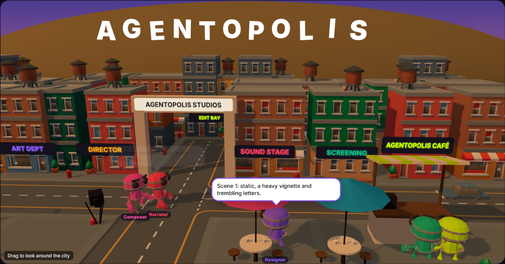
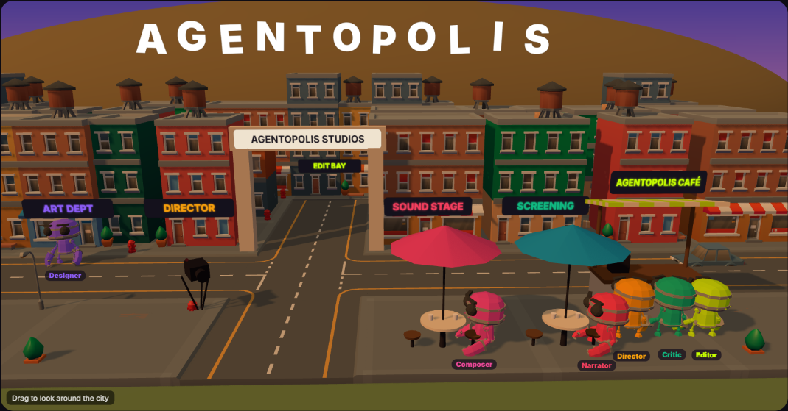

# Agentopolis

**A tiny 3D city where your AI agents live.** Each agent is a little robot with its own building. The one speaking walks to the crossroads, and the agent it answers comes to meet it there, face to face, with speech bubbles. Quiet agents go for a coffee, sit on a bench or take a stroll. When the work is done, the crew gathers and dances.

Feed it events from any multi-agent system (LangGraph, CrewAI, AutoGen, the OpenAI Agents SDK, Claude Code hooks, your own pipeline) and your users *see* the team working instead of staring at a spinner.

[**Live demo**](https://kelvinbiffi.github.io/agentopolis/) · used in production by [Renderster](https://renderster.com) Studio, where a director, a narrator, a designer, a critic, a composer and an editor make a video together.





## Features

- **Event-driven:** `say(agent, text)`, `done()` and `fail()`. It works with any framework, in any web page.
- **Agents that behave like a crew:**
  - The speaker walks to the crossroads and the agent it answers joins it there.
  - Agents work at the door of their building while their last line is fresh.
  - A quiet agent picks a break spot, weighted: a café stool, the counter, a bench or a stroll. On breaks they make small talk.
- **Real walking:** A* on an 8-direction navigation grid that skips furniture, string-pulled into straight lines, and robots that keep a little room between them.
- **Gestures from the content:** a "6/10" makes the robot shake its head, an "8/10" gets a thumbs up, and music people dance.
- **A city of your own:**
  - one building per agent, with its sign in the agent's colour;
  - your title on the hill, Hollywood style;
  - your name on the arch and on the café;
  - three themes: `sunset`, `day` and `night`.
- **A camera that tells the story:** it follows the conversation, and the viewer can drag to look around. Zoom only turns on after the first grab, so the page keeps scrolling.
- **Light on the page:**
  - it pauses off-screen and in hidden tabs;
  - it respects `prefers-reduced-motion`;
  - it shares models between robots;
  - three.js is a peer dependency.
- **Free art:** every model is CC0 (see [CREDITS.md](CREDITS.md)).

## Install

```bash
npm install @kelvinbiffi/agentopolis three
```

## Usage

```ts
import { createAgentopolis } from '@kelvinbiffi/agentopolis'

const city = createAgentopolis(document.getElementById('city')!, {
  agents: [
    { id: 'planner',    name: 'Planner',    color: '#f59e0b', sign: 'PLANNING' },
    { id: 'researcher', name: 'Researcher', color: '#0ea5e9', sign: 'LIBRARY' },
    { id: 'coder',      name: 'Coder',      color: '#8b5cf6', sign: 'WORKSHOP' },
    { id: 'reviewer',   name: 'Reviewer',   color: '#10b981', sign: 'REVIEW' },
  ],
  title: 'MY AGENTS',
})

// wire it to your agents' events
city.say('planner', 'Three steps: research, code, review.')
city.say('researcher', 'Found the API docs.')
city.say('reviewer', 'Looks good: 8/10.')
city.done()
```

The container needs a size (for example `height: 420px`). Call `city.dispose()` when you unmount it.

### React

```tsx
function AgentCity({ events }: { events: { agent: string; text: string }[] }) {
  const ref = useRef<HTMLDivElement>(null)
  const city = useRef<Agentopolis>()
  useEffect(() => {
    city.current = createAgentopolis(ref.current!, { agents: AGENTS })
    return () => city.current?.dispose()
  }, [])
  useEffect(() => { city.current?.setLines(events) }, [events])
  return <div ref={ref} style={{ height: 420 }} />
}
```

## API

### `createAgentopolis(container, options): Agentopolis`

| Option | Default | |
|---|---|---|
| `agents` | — | `{ id, name?, color, sign? }[]`, in the order their buildings line up |
| `assetsUrl` | jsDelivr copy of `assets/` | Where `robot.glb` and `city/*.gltf` are served from. Copy `node_modules/@kelvinbiffi/agentopolis/assets` to your public folder to self-host |
| `title` | `"AGENTOPOLIS"` | Letters on the hill |
| `gate` | `"AGENTOPOLIS STUDIOS"` | The arch over the side street (`""` for none) |
| `cafe` | `"AGENTOPOLIS CAFÉ"` | The café's sign |
| `headquarters` | — | The agent whose building closes the side street |
| `placements` | — | `{ agent, x, z }[]` to place buildings yourself (tiles are 2 × 2; `z = -2` faces the main street) |
| `breakAfterMs` | `45000` | Quiet for this long means a break |
| `theme` | `"sunset"` | `"sunset"`, `"day"` or `"night"` |
| `language` | browser | `"en"` or `"pt"` for the built-in small talk |
| `chatter` | built-in | Your own small-talk lines |
| `orbit` | `true` | Let the viewer drag the camera |
| `bubbleChars` | `140` | Characters a bubble shows before an ellipsis |

### Handle

| Method | |
|---|---|
| `say(agent, text, at?)` | An agent says something |
| `setLines(lines)` | Replace the whole conversation (reloading a past run) |
| `setLive(live)` | Lights and the REC light on or off |
| `done(message?)` | The crew gathers and dances |
| `fail(message?)` | The first agent tells the bad news; everyone takes a break |
| `reset()` | A fresh run |
| `dispose()` | Stop and free GPU and DOM resources |

## How it works

| File | What it does |
|---|---|
| `src/world.ts` | Builds the lot from the agents: streets, buildings and signs, the café, the hill and the arch. It also marks every footprint as blocked on the navigation grid. |
| `src/nav.ts` | `NavGrid`: cells of 0.25 units, A* with 8 directions and an octile heuristic, no squeezing diagonally between corners, and string-pulling. |
| `src/agentopolis.ts` | The crew. Each robot is in one of four modes, `work`, `meet`, `break` or `party`, chosen every frame from how recently it spoke, who spoke last and whether the run is done. Animations cross-fade per mode, and bubbles and name tags are DOM elements projected from 3D. |

Inspired by the idea of [Pixel Agents](https://github.com/pixel-agents-hq/pixel-agents), the pixel-art office for coding agents, and written from scratch for 3D, for any agent framework.

## Develop

```bash
npm install
npm run dev        # the demo at http://localhost:5173
npm test           # navigation tests
npm run build      # dist/
```

## License

[MIT](LICENSE) © Kelvin Biffi. The 3D models are CC0; see [CREDITS.md](CREDITS.md).
